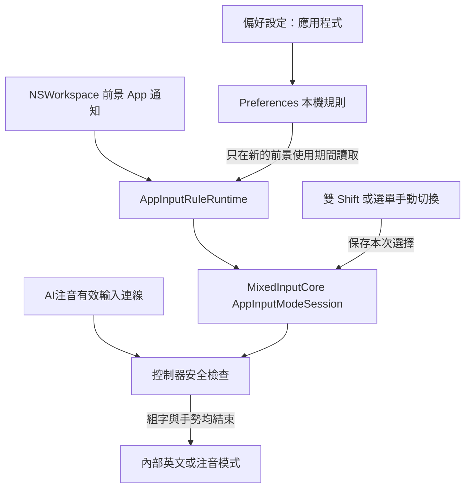

# 依應用程式切換英文／注音

更新時間：2026-11-15T21:47:22+08:00

1.3.0-dev.1 新增應用程式規則。功能預設關閉、規則清單空白；不需要先建立配置檔，也不需要 Vim 套件。

## 設定方式

1. 開啟「AI注音輸入法偏好設定 → 應用程式」。
2. 按「加入應用程式…」，選取 `.app`，再選「預設英文」或「預設注音」。新加入的規則先設為英文。
3. 或按「加入終端機範例」：加入目前已安裝的 iTerm2／Terminal 英文規則；已有規則保留，不自動打開總開關。
4. 勾選「啟用應用程式輸入模式規則」。
5. 切到其他 App，再回到指定 App，讓新設定生效。刪除規則或關閉總開關也從下次切入生效。

清單顯示 App 名稱、圖示與識別碼；名稱相同的不同 App 不會混用規則。同一識別碼只保留一條，重複加入不覆寫原本模式。App 搬移後仍依識別碼辨識；若已移除，規則可自行刪除，圖示可能顯示通用圖示。

## 實際行為

| 操作 | 結果 |
| --- | --- |
| 選用 AI注音，切進已設英文的 iTerm2 | 進入 AI注音內部的全英文直接輸入 |
| 在 iTerm2 雙擊 Shift 切注音 | 保留手動選擇，不反覆強制英文 |
| 同一 App 換分頁、視窗或輸入欄位 | 本次手動英文／注音選擇沿用，不搬移組字 |
| 切去另一個 App，再回 iTerm2 | 重新套用預設英文 |
| 選用 ABC 或其他系統輸入法 | 不介入、不搶回 AI注音 |
| 正在組字或進行 F／Shift 手勢 | 等待安全狀態；不自動送出、刪除文字或接受預測 |
| 未設規則的 App | 維持原本輸入模式行為 |

這是 App 層級的規則，**不辨識終端機內的 Vim、Shell、SSH、tmux 或不同工作分頁**。例如 Vim 與 Shell 都在 iTerm2 裡，仍視為同一個 App；需要中文時可手動雙擊 Shift。現有 Vim 配置不會被讀取或修改。

「英文／ASCII 組字」仍由原功能處理，不改成跨欄位保留整段英文。手動選取這個功能會解除當次英文預設的強制目標，完成組字後回注音；離開 App 再返回才重新套用規則。

F 分層及 Shift＋F 大小寫規則沿用 1.2.0。自動切換只在安全切換且模式有變更時嘗試顯示既有游標提示；應用沒有有效游標位置時不強行顯示。

## 隱私與失效處理

- 只使用前景 App 的 bundle identifier、程序識別及 AI注音輸入連線；不讀網頁、文件、視窗標題、終端機輸出或使用者輸入文字。
- 不加入全域鍵盤監聽、不切換 TIS 系統來源、不開啟鍵盤設定、不要求額外輔助使用授權。原有 F 分層輸入監控需求維持原樣。
- 設定保存在既有偏好網域，鍵為 `AppInputRulesEnabled` 與 `AppInputRulesJSON`，不寫私人詞庫、SQLite 或雲端。
- 無法確認前景 App、連線不符、非主執行緒或 Secure Input 時不套用。舊 App 的要求不能控制新連線。
- 規則資料有格式或版本錯誤時回退空規則，不影響原本打字。最多 256 條規則，儲存格式版本為 1；不自行猜測未知版本。

## 實作與依賴

`AppInputRuleSettings` 負責有界設定、重複識別碼與版本驗證；`AppInputModeSession` 依 App 識別碼及程序識別建立新的使用期間。手動選擇、設定快照與代次由所有輸入欄位共用，組字仍屬各自控制器。

macOS runtime 只在前景通知與連線啟用時更新 App 身分，過期通知以目前前景為準。控制器在 activate／setValue 完成後及完整按鍵事件的前後查詢快取，不在引擎同一事件的多段狀態回呼中間切換。按鍵路徑不掃描 App、不解碼規則、不讀檔、不呼叫 AI。

## 人工驗收清單（尚未執行）

1. 全新偏好：功能關閉、清單空白；升級後既有輸入行為不變。
2. 加入範例後總開關仍關閉；先設 iTerm2 為注音，再按範例，原設定不能被改成英文。
3. 開啟規則，離開再進入 iTerm2：英文生效。雙 Shift 切注音，換分頁、視窗及輸入欄位仍保留；跨 App 返回才重設英文。
4. 給另一個 App 設注音；快速往返兩個 App，不發生背景 App 改掉前景模式。
5. 使用 ABC 或其他來源時，App 切換不搶回 AI注音；重新選 AI注音後才套用當次規則。
6. 組字途中、候選選取、F 分層及首字母長按期間，不重複提交、不漏字；手勢結束後再驗證規則。
7. 回歸 Ctrl＋2～9 加詞、Shift＋F、雙 Shift、ASCII 組字、正常快速注音及 iTerm2 實鍵。
8. 檢查五個偏好頁籤、長 App 名稱、空清單與多條規則的版面；驗證刪除、關閉與再次進入 App。

以上需實機驗收；無介面測試及編譯不能證明所有應用程式的 IMK 行為一致。
