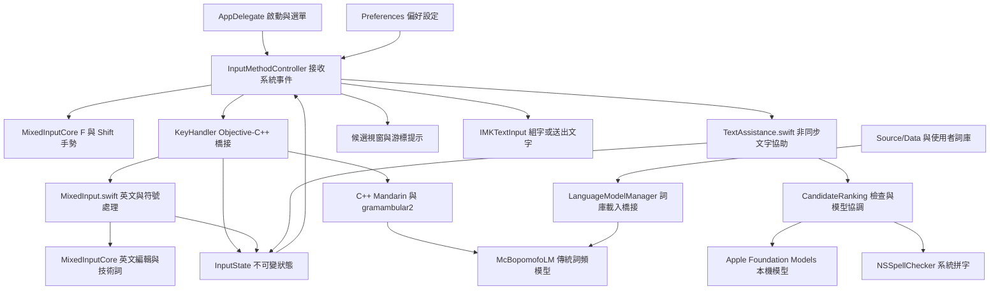
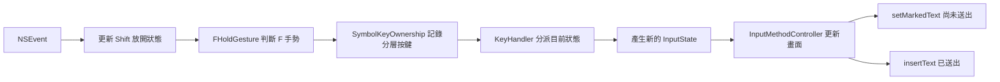
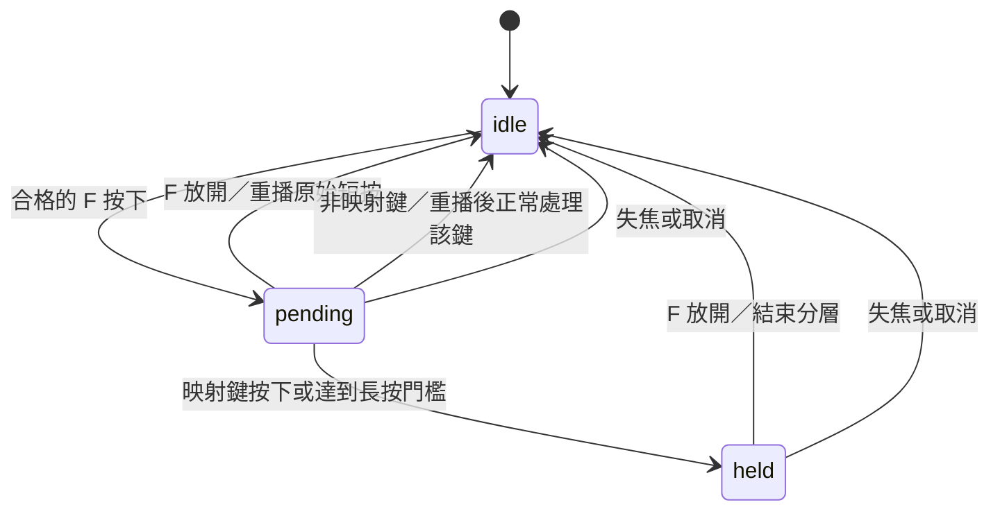
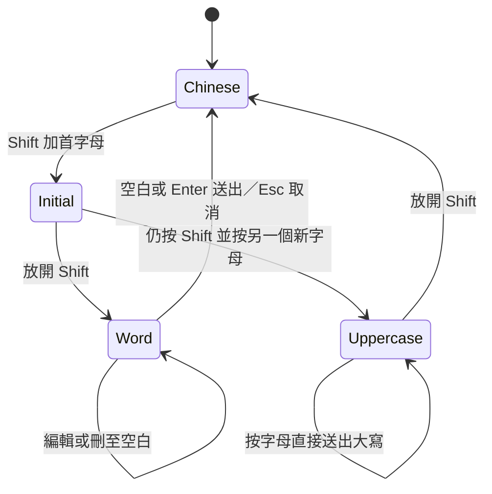
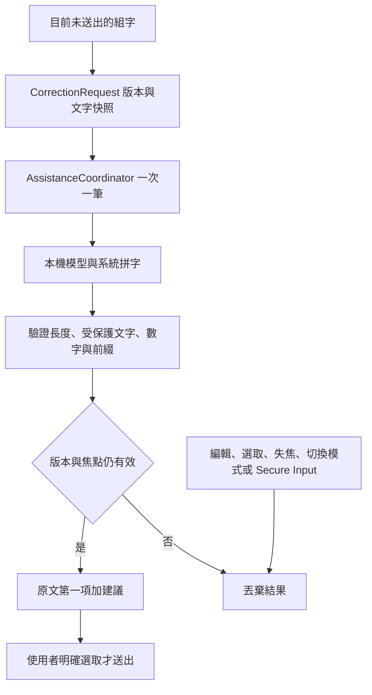
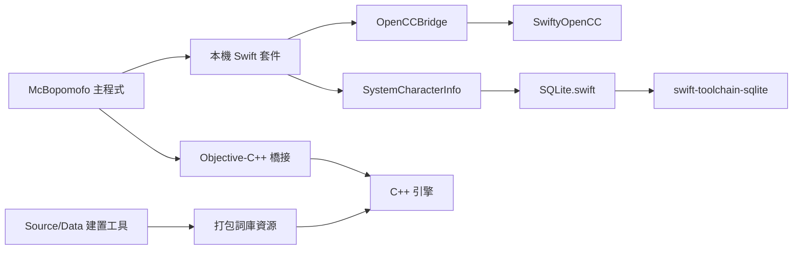
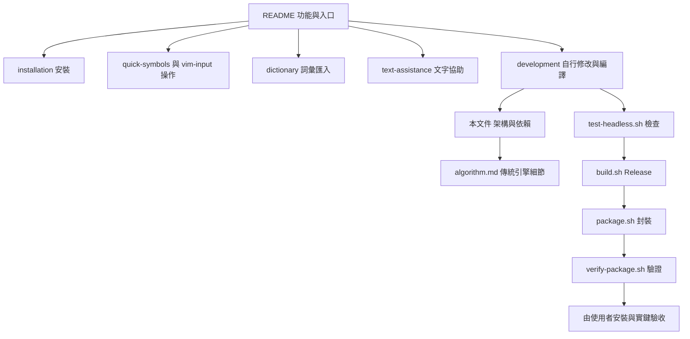

# AI注音程式架構與相互依賴

這份導覽從「按下一個鍵」開始，連到對應原始碼與修改入口。產品名稱是 AI注音輸入法，內部 Xcode target 仍叫 McBopomofo。小麥注音原作者與 MIT 授權保留在 [LICENSE.txt](../LICENSE.txt)。

## 先看全貌

箭頭表示呼叫或使用，不表示所有程式都在同一執行緒。

自訂英文技術詞沿用 LanguageModelManager 的使用者詞庫格式；AppDelegate 重載詞庫時建立有限大小的記憶體快取，普通按鍵不讀取磁碟或呼叫模型。產品識別與預設資料目錄和上游分開，內部 target 名稱保留以利同步。

傳統詞頻模型負責注音選字；Foundation Models 負責另外請求的文字建議。即使 Apple 模型不可用，注音、F 分層和英文組字仍可工作。

## 一個按鍵如何變成文字

F 組合鍵必須先讓手勢進入符號層，再記錄該鍵屬於符號層，最後處理同一事件一次。若先記錄按鍵，首鍵可能還被當成普通輸入，放開 F 後的重複事件也會判錯。

主要閱讀順序：

1. [InputMethodController.swift](../Source/InputMethodController.swift)：事件入口、F 計時器、監聽生命週期與狀態呈現。
2. [KeyHandler.mm](../Source/KeyHandler.mm)：先分派英文／符號／文字協助，再進入傳統注音流程。
3. [InputState.swift](../Source/InputState.swift) 與 [MixedInput.swift](../Source/MixedInput.swift)：狀態帶著組字、游標與候選；狀態變化以新物件表示。
4. [McBopomofoLM.cpp](../Source/Engine/McBopomofoLM.cpp) 與 `Source/Engine/gramambular2/`：查詞、詞頻及組句路徑。

## F 分層與監聽生命週期

- `pending` 時保存原 F 事件並啟動 `FReleaseMonitor`；標記文字讓 iTerm2 知道這個鍵由輸入法處理。
- `pending → held` 提前啟動只產生 `beginLayer`，不可產生 `invalidate`。F 尚未放開，監聽與健康檢查仍需要存在。
- 監聽器只在 F 手勢期間被動觀察 F key-up，其餘鍵碼立即丟棄。它不記錄打字內容，也不取代 macOS 授權。
- `SymbolKeyOwnership` 保留已處理映射鍵的歸屬，避免放開 F 後殘留的 key repeat 變成一般字母。
- 短按 F 回原注音／英文處理；F 與映射鍵實際重疊就視為組合鍵。因此快速打字須先放開 F 再按下一鍵，無法從相同事件序列推測不同意圖。

修改入口：[QuickSymbolLayer.swift](../Packages/MixedInputCore/Sources/MixedInputCore/QuickSymbolLayer.swift)、[控制器內的 FReleaseMonitor](../Source/InputMethodController.swift)、[F 操作說明](quick-symbols.md)。

## Shift 的兩種英文方式

`ShiftLetterSession` 是純 Swift 決策；`InputState.ShiftASCII` 記住入口與模式。選單啟動的 `ASCII` 可輸入整句，雙擊 Shift 的直接英文模式交由應用程式接鍵，兩者都不套用上圖的單字退出規則。

F 暫存／符號狀態會包住原英文狀態。Shift 放開時必須更新內部狀態，但保留外層 F 手勢，直到 F 真正放開。所有預測與編輯都透過 `ASCII.replacing` 複製，避免遺失 Shift 啟動方式。

修改入口：[ShiftLetterSession.swift](../Packages/MixedInputCore/Sources/MixedInputCore/ShiftLetterSession.swift)、[Shift 使用說明](vim-input.md)。

## 本機文字協助與失效規則

不讀取游標前後已送出的文件，不保存私人輸入歷史。中文校正限定等量漢字替換，避免刪去「再」或擴寫。容量語境的 `ML → mL` 是驗證例外，並非自動替換文字；其餘數值和技術名稱仍受保護。預測只能接在原字串後面。

NSSpellChecker 回呼可能在任意佇列執行：背景回呼使用 `nonisolated Sendable`，更新畫面前切回 `MainActor`。取消、逾時和過期結果都不能修改新組字。

修改入口：[文字協助說明](text-assistance.md)、[CandidateRanking](../Packages/CandidateRanking/Sources/CandidateRanking)、[Source/TextAssistance.swift](../Source/TextAssistance.swift)。

## 套件與資料依賴

| 本機套件 | 用途 |
| --- | --- |
| MixedInputCore | F 手勢、符號映射、Shift 模式、英文編輯、技術詞比對 |
| CandidateRanking | 文字協助請求、模型供應器、保護驗證與非同步生命週期 |
| CandidateUI | 選字與建議視窗 |
| TooltipUI、NotifierUI | 短暫提示與通知介面 |
| InputSourceHelper | macOS 輸入來源工具 |
| FSEventStreamHelper | 監看詞庫檔案變化 |
| NSStringUtils | 字串與橋接工具 |
| BopomofoBraille | 注音轉臺灣點字 |
| ChineseNumbers、RomanNumbers | 中文數字與羅馬數字轉換 |
| OpenCCBridge | 中文字形轉換橋接 |
| SystemCharacterInfo | 字元資訊資料查詢 |
| InfoCollector | 系統資訊收集工具；不是打字內容日誌 |

套件目錄存在不表示每個 target 都使用它；實際連結以 `McBopomofo.xcodeproj/project.pbxproj` 和各 `Package.swift` 為準。外部版本以儲存庫的 `Package.resolved` 固定，不隨意更新。

## 文件與修改路線

小修改先找對應純 Swift 套件與測試。只有注音演算法問題才進 C++ 引擎；詞庫內容修改另讀 [Source/Data/AGENTS.md](../Source/Data/AGENTS.md)。編譯、封裝與推送原始碼都不等於安裝；`build-for-testing` 只編譯整合測試，不能宣稱已完成實鍵驗收。
