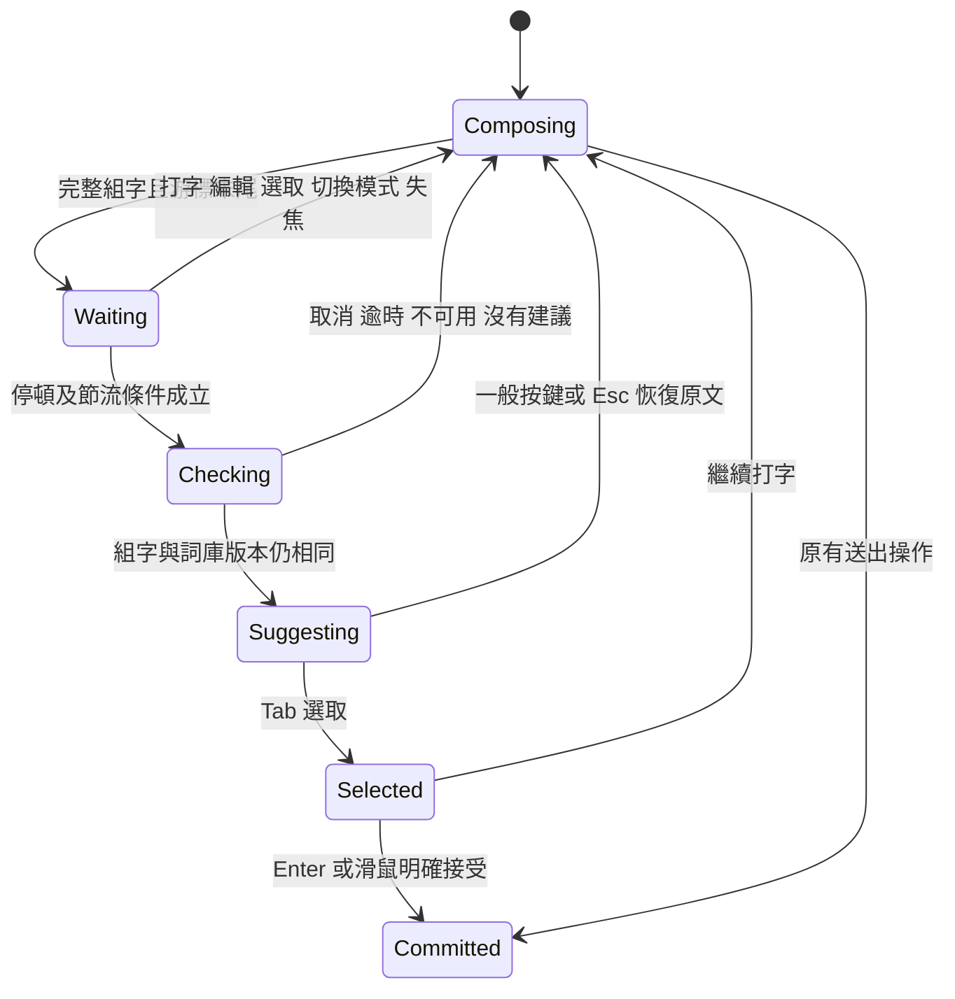

# 停頓後自動提供 AI 建議

0.6.14-dev.1 開發版將模型作為組字旁的副駕駛。預設啟用，可在第一層選單切換「停頓後自動提供 AI 建議」。此開關與英文續寫、詞彙觀察及 FM 背景整理分開。

## 本版操作

- 完整中文組字至少兩個漢字、游標在末尾，停頓約 700 毫秒後嘗試校正。仍有未完成注音、正在選字或編輯中間位置時不啟動。
- 英文／ASCII 組字沒有既有補全候選時，可對 3–64 字元的單一英文或技術碼提出拼字及 Unicode 排版建議。工程、私人與已核准候選優先。已有候選或連續按住 Shift 大寫時不介入。
- 自動請求至少間隔兩秒；同一份組字只嘗試一次。若上一筆剛啟動，停頓等待可長於 700 毫秒。推論本身另需時間，不宣稱總延遲為 700 毫秒。
- 推論期間不切換組字狀態、不顯示檢查中的候選視窗。只有有結果時才顯示原文與標成「AI 建議」的候選。
- 原文預設選中。Tab 循環選取，選中建議後 Enter 明確送出；也可用滑鼠點選。直接 Enter 走原本的提交流程。
- 繼續打字、退格、方向鍵、快捷鍵或 F，先恢復原組字，再處理原按鍵。數字不會被當作自動提示的候選快捷鍵。Esc 隱藏提示，保留原文。
- 沒有自動英文校正時，沿用既有英文預測流程；有續寫提示時仍由 Tab 接受。工程候選存在時不被模型預測覆蓋。
- 模型忙碌、不可用、逾時或建議被驗證拒絕時不彈出錯誤視窗、不修改文字。仍可手動使用「檢查錯字／英文拼字」查看結果狀態。

## 能力與限制

`我在去一次 → 我再去一次` 是可能的中文建議，不是固定取代規則。模型可能沒有建議或判斷錯誤，故仍需明確選取。

技術排版例如 `al2o3 → Al₂O₃`。Unicode 上下標必須能還原為同樣的字母、數值及符號；另容許已知希臘字母名稱對應字元。不能把 `Al₂O₃` 改成 `Al₂O₄`，也不將未知縮寫展開成未經確認的專有名詞。這個檢查只保護字面身分，不能證明化學或物理語意正確。

已預載的 `sio2`、`lambda` 等仍由詞庫立即提供；模型不取代既有詞庫。技術排版允許明確接受後改變大小寫，但私人保護詞不被這個模式繞過。

本版不讀已送出的文件、剪貼簿、其他應用文字，不保存句子歷史，不自動部署模型候選。模型只接收本次未送出組字。未來上下文記憶僅為 [規劃討論](context-assistance-proposal.md)。

## 生命週期

模型在既有獨立 XPC 服務中執行，只有一個推論名額。取消後的舊結果不得覆蓋新組字。這次沒有修改 FReleaseMonitor 或 F 手勢狀態機。

## 實鍵驗收清單（尚待使用者執行）

1. 組出「我再德國」，保持未送出並停頓。若有建議，先直接 Enter，必須送出原文；另一次用 Tab 選取後 Enter，才送出選定建議。
2. 建議出現後打字、按數字、退格、左右移動及 Esc，確認沒有誤選建議或漏字。
3. 建議出現後按短 F、F＋R、F＋Esc、長 F＋U／M、按住 F 退格與放開，確認既有行為。
4. 檢查雙 Shift、Shift 英文組詞、持續 Shift 大寫、快捷鍵、一般注音候選與私人詞庫。
5. `sio2`、`i2c`、`lambda` 應先顯示既有工程候選；未知技術碼的模型結果不保證出現或正確。
6. 等待推論時切換欄位、模式、詞庫或關閉開關，舊結果不得回來；Secure Input 不觸發模型。
7. FM 不可用時仍可輸入；沒有提示本身不能證明模型已正常運作。

更新時間：2026-11-04T23:55:32+08:00
