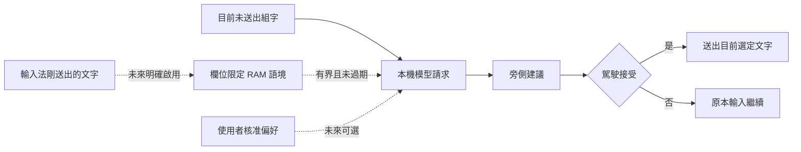

# 語境副駕駛：未來規劃討論

狀態：提案，尚未實作或啟用。本文件不授權保存額外資料。現行功能仍只將未送出組字交給文字協助模型；SQLite 保存受限詞彙彙總，不保存句子。

## 先區分三種記憶

1. **短期語境**：將少量剛送出的文字隨下一次請求提供給模型。這是提示上下文，不是模型權重學習。建議只保留在記憶體，過期或離開目前輸入欄位就清除。
2. **長期詞彙偏好**：沿用目前的觀察、校對與核准詞庫，例如偏好 `mL`、特定術語或縮寫，與句子歷史分開。
3. **長期寫作偏好**：未來由使用者逐項核准的簡短規則，例如「採臺灣工程慣用語」或「避免自動展開縮寫」。模型只能提案，不能把單次輸入推斷成永久個性或語法偏好。

## 建議第一階段：短期語境

候選起點為最近三次提交、總計不超過 1,000 字元、最長五分鐘，僅存在 RAM，預設關閉；數值須經體驗與風險討論確認。只使用本輸入法確實送出的文字，不讀取客戶端文件或其他輸入法的內容。

不同輸入欄位絕不混用；若 IMK 無法可靠辨識欄位身分，採更保守的失焦即清除。Secure Input、停用功能、切換輸入來源與使用者按「清除語境」都立即失效，取消進行中的推論。已送出文字若被應用程式修改或刪除，快取可能過時，因此只作提示，不能當成完整文件事實。

畫面應明確顯示是否正在使用短期語境及剩餘保留時間，不顯示可能洩漏內容的通知。模型輸出仍只對目前未送出組字提出建議，不回寫之前的文件文字。

## 第二階段：核准式個人偏好

先讓使用者自己新增偏好，再評估模型能否提出可審核的規則。正式保存只包含規則、適用範圍、來源類型與核准時間；不附原始句子或私人例句，不推測身分、健康、情緒等個人屬性。規則可查看、編輯、停用與刪除，並獨立於詞庫版本。

不建議第一版保存完整長期句子歷史或向量搜尋庫。它們會增加敏感內容保存、跨工作內容混用、刪除一致性與提示注入的風險；如未來確有需求，應另訂明確範圍、加密、保存期限與可驗證的清除機制。

## 必須先決定的產品問題

- 語境是否只在同一欄位有效？建議是，跨欄位先不做。
- 是否在所有應用啟用？建議先採使用者明確允許的應用清單。
- 是否記住句子到下次開機？建議否，長期只保存核准偏好。
- 是否修正已送出的文字？建議維持否；這應是另一個需要文件編輯權限的功能。

## 驗證門檻

以合成情境比較「只有目前組字」與「加入短期語境」的正確率、誤導率、建議接受率及延遲，不能只展示成功例子。測試跨欄位隔離、逾時清除、Secure Input、模式切換、模型取消與過期結果拒絕。確認沒有寫入磁碟、日誌、備份及 JSON 匯出。未達到效益與隱私門檻前維持關閉。

塔台負責規則與檢查，副駕駛提供有限建議，駕駛保有最後決定。模型的「理解」來自當次提供的資訊與能力，不代表它會自行持續記住所有對話或輸入。

更新時間：2026-11-04T23:55:32+08:00
