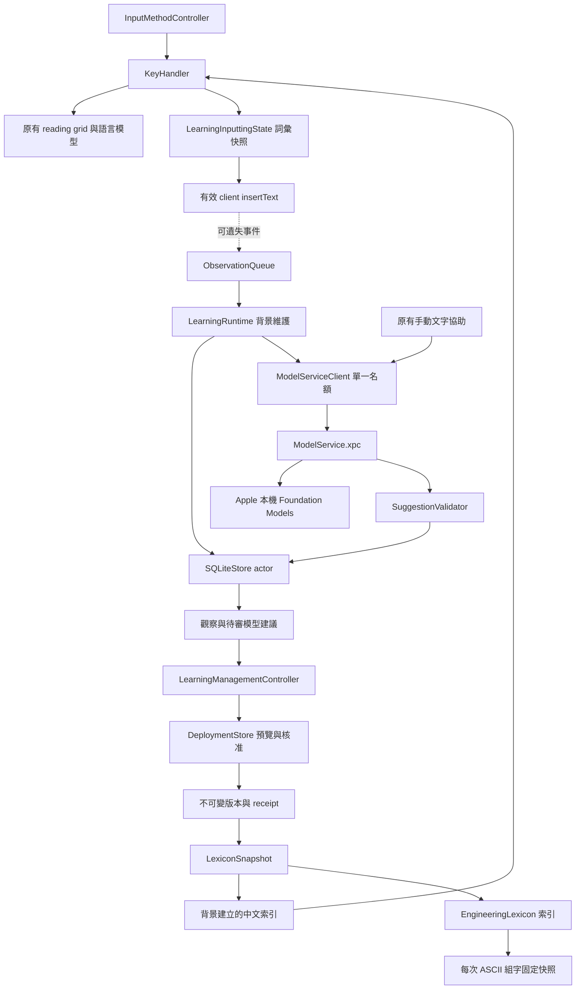
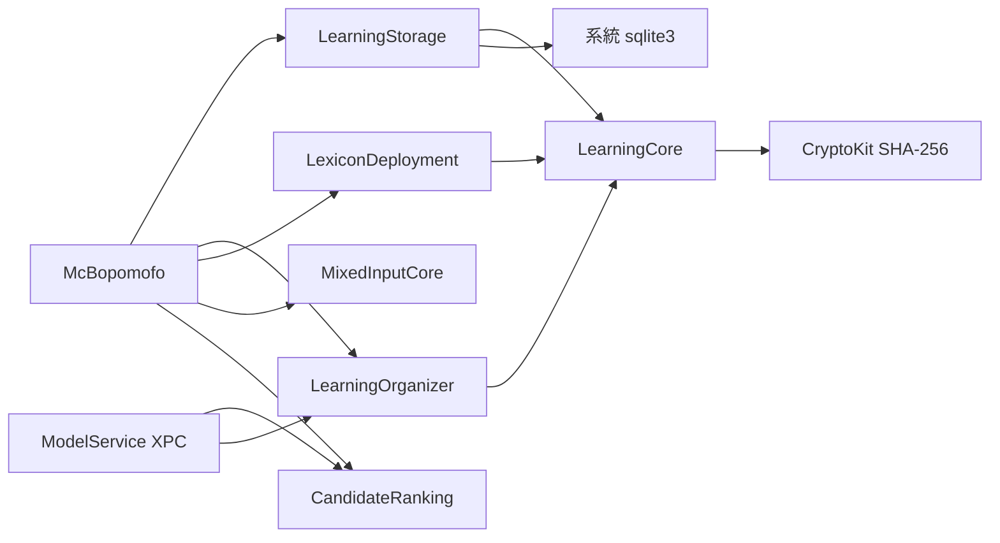

# 實際模組與資料流

沒有新增雲端模型、常駐 launch agent 或另一個管理 app。XPC 由 app 內嵌並按需啟動，watchdog 只終止服務自身，不結束輸入法。輸入法啟動不等待服務可用。

中文最小引擎擴充為 selectExternalCandidate：未選取時不建立模型節點；選取時建立暫時覆寫，改選／相關讀音編輯恢復原有行為。空的暫時節點取消覆寫後不參與正常最佳路徑。它不寫入基礎詞庫與私人詞庫。

管理視窗及每次組字之外的背景工作可掃描有界資料集；按鍵路徑只取已建索引與有限候選，不建立整份詞庫索引。

實作參考：[Apple Foundation Models](https://developer.apple.com/documentation/FoundationModels/generating-content-and-performing-tasks-with-foundation-models) 的模型可用性與非同步生成介面；資料庫一致性備份遵循 [SQLite Backup API](https://www.sqlite.org/backup.html)。這些 API 文件不代表本開發包已完成真實模型或 XPC 實機驗收。

更新時間：2026-11-04T02:48:30+08:00
