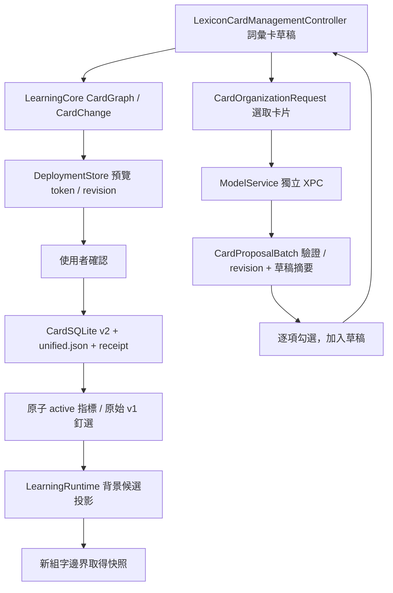
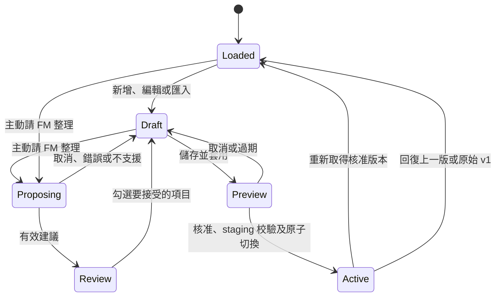

# 共用詞彙卡 SQLite v2 開發契約

狀態：獨立功能分支開發中，尚未合併或發布。更新時間：2026-11-16T23:21:28+08:00。

## 共同契約

以 [固定 DDL](../../schemas/lexicon-cards-v2.sql) 為準。application_id 維持 0x4149424c；user_version=2；metadata 恰四鍵 format=ai-bopomofo.sqlite、schema_version=2.0.0、document_type=review/approved、dictionary_version。與 v1 並存；不修改既有 v1 DDL。檔案最大 16 MiB。

九種值資料與 metadata 表：concepts、forms、names、readings、pronunciations、bindings、relations、legacy_links、origins。所有 ID 為 64 位小寫十六進位字串；新建由 UUID 的 UTF-8 SHA-256 產生，編輯保留 ID；遷移由 namespace + ':' + 舊 entry_id 的 UTF-8 SHA-256 產生。namespace 依序 concept/form/name/reading/pronunciation/binding。陣列順序以 SQLite rowid 插入順序保存，不以 ID 排序。legacy_links 無獨立 ID。

- concepts: id、definition（1–256 UTF-16 units）、domain（0–80）。
- forms: id、text（1–128）、kind=zh/en/abbreviation/symbol。
- names: id、concept_id、form_id、source。每張卡可以包含多種名稱；同一 form 可屬多卡；concept/form 組不可重複。
- readings: id、value。標準注音以 '-' 分音節；與現有引擎 adapter 一樣只啟用符合既有中文詞條驗證的讀音。
- pronunciations: id、name_id、reading_id、source。只連中文名稱，name/reading 不重複，依詞義限制多音字。
- bindings: id、name_id、reading_id、code、term_type、source。term_type 沿用 zh_phrase/english_term/technical_alias/unicode_mapping。中文須有同 name/reading 的 pronunciation，code 等於該 reading.value；非中文 reading_id 為空字串。name/type/code 不重複。每個 binding 輸出其 name 所連 form.text；語意關聯不產生額外候選。
- relations: id、source_id、target_id、kind=broader/related、source。端點為概念，禁止自身關聯；broader 表示 source 的上位概念為 target，不擴展候選、不宣稱傳遞閉包。
- legacy_links: source_id、target_id。只保留 v1 equivalent 的歷史資訊，不代表同義已驗證。
- source 為 1–512 字元來源描述，不是核准授權。Unicode 不做 NFKC，原始大小寫、上標下標保留。
- concepts/forms/readings/bindings 上限各 20,000；names/pronunciations/relations/legacy_links 各 40,000。所有端點須存在，拒絕重複 ID、控制字元與非法讀音。嚴格 schema allowlist，不接受額外表、trigger、view、extension 或外來 migration SQL。

- origins: id、subject_id、source、reference。來源紀錄指向有效物件，保留原始查證網址與 FM 提議理由；最多 40,000 筆，source/reference 各 512 字元（reference 可空）。它只是來源描述，不代表外部網址已驗證。

## 安全與交換

外部 approved 仍須本機預覽與確認。正式核准部署維持 staging、校驗、原子指標、五版歷史及復原 JSON。模型建議另存待審，不得因 source=apple_fm 自動部署。匯出從不可變快照建立已關閉的獨立 SQLite，不搬 WAL/SHM 或私人使用紀錄。

只選取一張卡時攜帶其名稱、讀音與 bindings；與未選卡的 concept relation 不匯出，也不遞迴拉入整個關聯圖，UI 必須告知跨卡關係可能省略。建議完整匯出保存全部關係。舊 JSON 1.0 不能保留詞彙卡，禁止靜默降級。兩平台可相同 ID 合併，內容變動先呈現差異；同字不同 ID 不自動去重。

## 遷移

每個 v1 entry 先產生獨立 concept，保留 text、reading、type、source、annotation/domain；讀音建立在該名稱；舊 equivalent 保存 legacy_links。不依 connected components 合併詞義。首次核准後才寫 v2，讀取舊版本不寫回；回復可返回 v1。原使用者 data.txt / chewing.dat 與內建詞庫不被改寫。

## FM 與介面

一張卡一個詞義。中文/注音、英文、縮寫、符號同畫面；名稱可多筆。模型依選定卡與有限相關卡提出修改、名稱、讀音、關係；每個操作獨立選取，依 base revision 防止過期結果。人工修改與 FM 建議都須預覽確認才部署。模型不可用仍可完整人工編輯與輸入。

Windows 不需 Apple FM 才能讀取、人工編輯、核准及使用卡片。Mac 與 Windows 各用 adapter 接現有引擎，不換核心；新快照只在安全組字邊界取得。

## 驗收

Swift/Rust 各自讀取同一合成 fixture，互讀各自輸出。測試多義 bank、多音字、共享 form、兩張卡共用讀音、上下標、重複與孤兒關係、v1 遷移、外部核准、取消/過期預覽、SQLite 故障與回復。模組/編譯不代表 GUI 或實鍵驗收。不得安裝、重啟、合併或發布。

## 實際模組與狀態

card-proposals.json 為本機待審 session，包含草稿及提議，最大讀取 16 MiB、權限 0600；不隨正式詞庫匯出。卡片編輯的完整驗證與大型匯入在背景執行。舊學習資料庫 learning.sqlite 保持獨立，沒有把觀察紀錄當成正式詞庫。Mac 應用程式開發版本為 2.0.0-dev.1，詞庫 Schema 為 2.0.0；均不代表標籤、合併或發布授權。

首次由 v1 核准到 v2 時以 preserved-v1.json 釘選原版本，五版一般輪替不得刪除；可明確回復原版。失敗的部署不得替換 active。來源 origins 保存原始查證網址與已接受 FM 理由，但不將模型理由當成外部查證。

目前中文投影沿用既有 1–8 字限制；原生九字詞原檔與輸入不改寫，匯入會報告跳過。模型不會在打字時遍歷圖或查 SQL。完整詞庫圖不是每次按鍵的查詢依賴。
