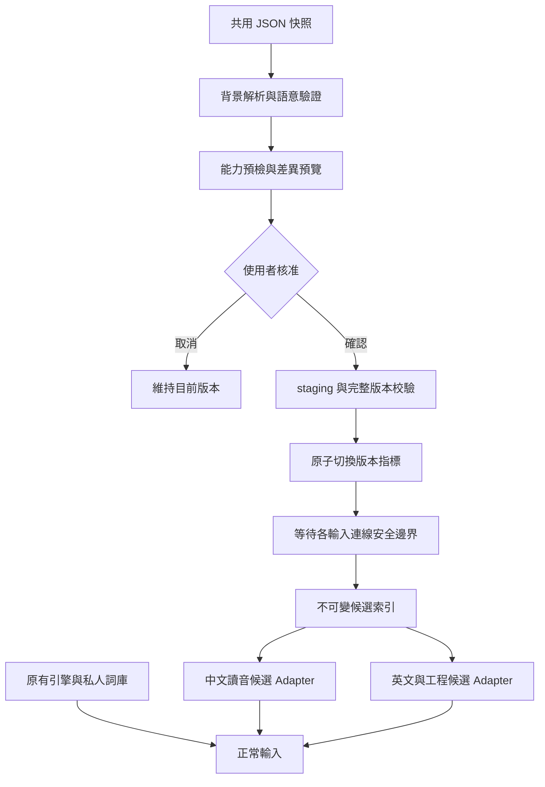

# 新酷音與 AI-Bopomofo 共用個人詞庫：配合規格與放置位置

更新時間：2026-11-08T17:11:53+08:00

狀態：設計與交接文件，尚未實作跨平台 Adapter 或啟用同步。本文所稱新酷音以使用者的 AI 新酷音 fork 為主要對象；AI-Bopomofo 是小麥注音衍生版本。原版新酷音與原版小麥注音不會因此自動支援此格式。

## 1. 決策摘要

- 共用已挑選的詞彙資料，以 JSON 快照交換；兩邊保留各自的引擎、原有私人詞庫與短期選字偏好。
- 沿用 `ai-bopomofo.lexicon` 交換格式，先提供 1.0.0 相容子集。新酷音的中文別名需要另外協調版本，不能直接塞入現有格式。
- 第一期採人工匯出、傳檔、匯入預覽、核准部署；不做背景雙向同步，不共用正在使用的 SQLite。
- 中文共用詞採 `candidate_only`。工程／英文仍保留原文第一候選，選取後才轉換。匯入使用次數不改寫引擎詞頻。
- 預載工程詞、私人自訂詞、AI 待審建議與已核准共用詞分開管理。FM、Ollama、GIS 都不是載入共用詞庫的必要依賴。

## 2. 已核對的來源與缺口

本次只讀程式碼與公開／專案文件，沒有讀取實際私人詞庫或使用者偏好。

| 專案 | 核對基準 | 主要檔案 |
|---|---|---|
| AI-Bopomofo | `9700690321df88b35ddf987a034e6cf18a7fb3c1` | `schemas/lexicon-v1.schema.json`、`Source/LearningRuntime.swift`、`Source/LearningManagement.swift`、`Packages/LexiconLearning/Sources/LexiconDeployment/DeploymentStore.swift` |
| Windows 外層專案 | `ab398f2b8dc4bd9fcb70f7cb049e742e37563585` | `policy-core/src/user_engineering.rs`、`policy-core/src/technical_lexicon.rs` |
| Windows 偏好工具 | `914f05f5f5f6dae0129e04ff327b26963019108b` | `upstream/windows-chewing-preferences/src-tauri/src/engineering.rs` |
| Windows TSF | `32793133aaa10752da17eabde617f0da9a42f4c8` | `upstream/windows-chewing-tsf/crates/chewing_tip_core/src/shell.rs`、`tip/src/text_service/chewing.rs` |

Windows 外層目前位於 `feature/shared-lexicon-v1`；本次未切換、提交或修改該工作目錄。交接執行者必須先重新檢查外層與兩個 nested repository 的分支、提交與未提交差異，再領取工作。以上基準不是未來可直接覆蓋的目標。

現況差異：

| 項目 | AI-Bopomofo | AI 新酷音 | 配合要求 |
|---|---|---|---|
| 交換格式 | Lexicon JSON 1.0.0 | 工程詞 `version: 1/2`、三／四欄 TSV | 新增交換 Adapter，保留舊格式 |
| 中文別名 | Schema 不接受 `zh_aliases` | v2 支援中文別名 | 不可默默丟棄；見第 5 節 |
| 身分 | 類型＋精確讀音／碼＋精確文字的雜湊 | 工程詞以 ASCII 不分大小寫輸入碼＋輸出去重 | 顯示大小寫碰撞，不私自合併 |
| 上限 | 20,000 筆、8 MiB、深度 12 | 現有工程私人詞 500 筆、256 KiB | 先做容量預檢，不截斷、不暗中提高上限 |
| 部署 | 核准、版本、校驗、回復、安全邊界載入 | 工程檔有鎖、revision 比對及原子替換；v1 升 v2 時備份 | 共用詞庫新增完整版本與回復流程 |

## 3. 詞庫放在哪裡

### 3.1 已存在的 macOS 程式路徑規則

```text
~/Library/Application Support/AI-Bopomofo/
├── data.txt                         傳統私人中文詞庫的預設位置
├── exclude-phrases.txt              傳統排除詞庫的預設位置
└── Learning/
    ├── learning.sqlite             長期觀察資料，不作共用檔案
    ├── snapshots/                  SQLite 備份操作建立的快照位置
    └── lexicons/
        ├── active.json             已核准版本指標
        ├── previous-active.json    前一次版本指標
        └── <SHA-256>/
            ├── lexicon.json        該版本完整擴充詞庫
            └── receipt.json        本機核准與校驗紀錄
```

目前帳號的預設根目錄為 `/Users/defu/Library/Application Support/AI-Bopomofo/`。`data.txt` 與排除詞庫可被既有自訂詞庫路徑設定改變；`Learning/` 目前由 Application Support API 獨立決定，不跟著該設定搬移。這是程式規則，未查詢使用者目前是否改用自訂位置，也未確認所有目錄都已建立。

不要手動替換 `active.json`、把外部 JSON 放入雜湊目錄，或複製別台電腦的 `receipt.json` 來跳過核准。透過「AI 詞庫管理 → 匯入詞庫 JSON」部署。

### 3.2 已存在的 Windows fork 程式路徑規則

```text
%APPDATA%\ChewingDev\
├── chewing.dat                      Editor 建構時明確傳入的私人詞庫路徑
├── engineering-terms.user.json      私人工程詞 v1/v2
├── engineering-terms.draft.txt      現有工程詞批次編輯草稿
└── engineering-terms.lock           工程詞儲存鎖
```

`chewing.dat` 依目前 `chewing_tip_core/src/shell.rs` 的 `Editor::chewing` 呼叫核對。不能沿用舊報告，把目前 fork 的檔名寫成 `userphrase.sqlite`；亦不推定其內部格式。既有工程候選另讀取 `technical-terms.txt` 等來源，共用詞庫不應覆蓋它們。

新功能建議新增以下本機目錄，**目前尚未建立或實作**：

```text
%APPDATA%\ChewingDev\SharedLexicon\
├── active.json
├── previous-active.json
├── versions\<SHA-256>\
│   ├── lexicon.json
│   └── receipt.json
└── staging\<operation-id>\
```

由偏好工具處理匯入、校驗與部署；TSF 只使用已驗證的記憶體索引。Windows 用 Known Folder／既有資料目錄工具解析路徑，不寫死帳號或磁碟機。保留正式新酷音的 `%APPDATA%\Chewing\`，不得搜尋或覆寫其私人資料。

### 3.3 建議的共用交換資料夾

Mac 建議使用：`/Users/defu/Documents/AI Bopomofo/SharedLexicon/`。與安裝包的版本資料夾並列，詞庫版本不依附 app 版本。

```text
SharedLexicon/                       建議位置，尚未建立
├── exports/
│   ├── mac-<UTC時間>-<checksum12>.json
│   └── windows-<UTC時間>-<checksum12>.json
└── incoming/                        使用者收到、尚待匯入的 JSON
```

時間檔名使用不含冒號的格式，例如 `20261108T091153Z`；檔案已存在就比較完整雜湊，不覆寫不同內容。`checksum12` 僅幫助辨識，驗證仍用完整 SHA-256。

Windows 由使用者選擇同一同步服務在當地的資料夾，不猜測 iCloud／OneDrive 的實際路徑。兩台路徑可以不同。只有在該 Mac 的「文件」確實納入同步、檔案完成下載時才可跨機取得；本次未驗證雲端同步狀態。

第一期不建立雙方共同寫入的 `latest.json`。每次匯出是獨立快照，另一台手動選檔、比較與核准。同步服務的衝突副本也作為獨立匯入檔處理。

**交換資料夾只放選定的詞庫 JSON，不放 SQLite、WAL、私人原始詞庫、逐鍵紀錄、模型對話、核准憑證或認證設定；不放進公開 Git repository。**

## 4. 新酷音需要配合的模組

以下為待實作設計，並非現有功能清單。



1. **交換模組：**在平台中立 Rust 層提供解碼、大小／深度限制、識別碼、去重與語意驗證。不要把 JSON 工作放入 TSF 按鍵回呼。
2. **偏好工具：**新增「匯出共用詞庫」「匯入共用詞庫」「啟用共用詞庫」「版本與回復」；顯示新增、已存在、修改、同音多詞、格式不支援與超量項目。匯出來源分別標示私人原有詞、共用已核准詞、AI 待審詞，不預設匯出所有資料。
3. **私人中文詞匯出：**核對固定版本 libchewing 的受支援列舉 API，取得可靠文字與讀音後才轉換；不要自行解讀 `chewing.dat` 二進位。若暫無可用 API，先接受使用者主動匯出的文本，標記自動匯出未完成；不能猜讀音。
4. **中文載入：**優先新增獨立 `candidate_only` 候選索引，接到既有讀音與候選事件。讀音必須來自組字引擎，不可反查已選漢字猜音；多音節跨度與游標位置須一致。若引擎無法提供可靠跨度，只啟用完整組字讀音比對，其他情況降級原生候選。
5. **中文提交：**明確選取共用候選後沿用現有提交佇列，只提交一次。不得直接呼叫會提升學習詞頻的新增私人詞 API，卻把效果標示為 `candidate_only`。此策略若無法安全實現，先標為不支援，不改傳統自動組句。
6. **英文／工程載入：**沿用原文優先與明確接受，將獨立共用詞庫與內建工程、既有私人工程索引組合查詢；不把匯入檔整批覆寫到 `engineering-terms.user.json`。
7. **切換版本：**偏好工具用舊 revision 檢查與單一寫入鎖；失敗保留舊版本。各 TSF 連線持有不可變快照，正在組字時保留舊快照，待提交或取消後更換；不強制重啟應用程式或輸入法。
8. **安全與回復：**拒絕檔案指定的任意路徑、外部連結抓取與控制字元；來源欄位只當資料。損毀／不支援時停用共用擴充，傳統輸入正常；回復上一版也走安全邊界。

Windows 使用者原有詞庫的匯出與原版小麥 `data.txt` 的匯出屬於另外兩個來源 Adapter。AI-Bopomofo 已有「擴充詞庫」JSON 匯出，不代表已完成傳統 `data.txt` 全部匯出。

## 5. 格式與無損相容契約

### 5.1 先支援既有 1.0.0

- 以現有 [Schema](../../schemas/lexicon-v1.schema.json) 與 [語意規則](schema.md) 為準，不能只通過一般 JSON Schema 驗證便部署。
- `term_type` 使用 `zh_phrase`、`english_term`、`technical_alias`、`unicode_mapping`。中文一至八音節、每音節對應一漢字；保留聲調，同音不同詞和同字不同讀音各自共存。
- 以 `ㄧ`（U+3127）表示注音，不把漢字「一」當作同一碼點；第一聲不加符號，輕聲依現有格式放在音節末，音節間以 ASCII `-` 分隔。來源不同表示法需經顯式轉換與驗證，不能直接改全部輸出文字。
- 識別碼：依序取類型、讀音／輸入碼、輸出文字的 UTF-8，各段前加 8-byte unsigned big-endian byte length，再取 SHA-256 小寫十六進位。兩語言用同一合成測試向量核對。
- 身分保留精確大小寫與 Unicode；不做 NFKC。查詢可忽略 ASCII 大小寫，但不得因此丟掉身分不同的原始詞條。
- 對外匯出不附帶可直接部署的本機授權。`document_type=approved` 和 `review.status=approved` 只能表示來源宣稱，接收端仍須預覽核准；`usage` 不累加成本機次數。
- 同一版本名稱內容不同時拒絕，要求重新命名版本；詞庫版本獨立於 app。重複匯入不得多加詞或重複計數。

### 5.2 中文別名需要明確的版本升級

新酷音 v2 的 `zh_aliases` 可表示 `甲烷 → CH₄`；這是已組好中文的轉換觸發，不是 `zh_phrase` 的注音讀音，也不是僅顯示的 `annotation`。現有 Mac 1.0.0 拒絕未知欄位且只接受固定版本，因此不能直接加欄位冒充相容。

建議第二步共同設計 1.1.0：增加選用 `zh_aliases`、兩端驗證器、候選行為、遷移與測試；未協商前不改正式 Schema。需保留目前 Windows 的上限及安全字元檢查，並核對 Mac 的 UTF-16／Unicode 規則。Mac 也要新增中文別名的明確選取轉換路徑，單有欄位不算支援。

第一期輸出 1.0.0 時：

- 沒有別名、通過兩端限制的詞可正常交換。
- 含別名的詞列為「不能完整轉換」，預設不宣稱完成；使用者可明確選擇只匯出基本碼／文字，原始 v2 檔保留，另顯示省略項目報告。
- 不把別名藏進註解，不靜默刪除，不用外掛 sidecar 假裝舊 Mac 已能還原。
- 既有 Windows 上限 500 筆／256 KiB 若不足，先擋下並讓使用者選擇分批；新的獨立共用索引上限須經效能測試後決定，不直接套用 20,000 筆。

## 6. 合併、排序與刪除

- 預設新增合併，檔案沒列出的本機詞不刪除。
- 同 ID 同內容跳過；同 ID 不同提示／分類顯示差異，由使用者決定；讀音或文字改變為新 ID。
- 同碼多義是合法候選，不當作必須刪除的錯誤。匯入內矛盾的重複 ID 拒絕；完全相同的重複項可合併並回報數量。
- macOS 現有合併流程可更新同 ID 的資料，但跨平台逐欄衝突選擇需補足 UI，不能宣稱現有預覽已完整實作這套互動。
- 英文與工程輸出按實際文字去重；相同候選不同來源須保留來源資訊。新增共用來源的穩定順序與現有候選上限需寫成測試，不因匯入次數改排序。
- 刪除只作用於使用者當下選定的本機共用版本；第一期不跨裝置傳遞刪除意圖。未來自動同步需另設 tombstone、共同基準與衝突處理，不能用缺詞或時間戳推定刪除。

## 7. 交給新酷音執行者的工作順序

| 階段 | 交付 | 通過條件 |
|---|---|---|
| A 現況確認 | 固定三個 repo 基準、讀音 API 與私人詞匯出能力報告 | 分清楚目前能力與待實作，不讀私人實檔 |
| B 交換核心 | Rust Schema 1.0.0、穩定 ID、合成 fixtures、Swift/Rust 對照 | 同一組輸入得到相同 ID；非法／不支援輸入明確拒絕 |
| C 管理工具 | 檔案選取、容量檢查、差異與核准 UI | 取消零變更；預覽後基準改變須重做；不覆蓋私人詞 |
| D 本機部署 | staging、校驗、版本、回復、記憶體索引 | 故障注入保留舊版本；DB／模型不可用時能輸入 |
| E 候選接入 | 中文候選、工程候選、安全快照切換 | 不重複提交、不改原生排序、不損 Unicode |
| F 相容擴充 | 共同確認 1.1.0 中文別名及容量 | 兩端皆通過遷移與候選行為驗證才啟用 |

Windows nested repo 修改需按當前專案規則更新可重播 patch series；乾淨 clone 必須能重現，不能只把忽略的 `upstream/` 改好就視為交付。

macOS 配合工作：增加傳統個人詞的選取匯出 Adapter、跨平台相容性預檢、逐欄衝突介面；後續才實作 1.1.0 別名。保留現有部署核准流程，不改寫 C++ 組字引擎。

## 8. 驗收矩陣

全部使用合成詞。尚未執行以下跨平台驗收：

1. 中文「磊晶」搭配 `ㄌㄟˇ-ㄐㄧㄥ`；同音不同詞、同字不同讀音、輕聲、補充平面漢字；無可靠讀音不能自動匯出。
2. `sio2 → SiO₂`、`i2c → I²C`、`lambda → λ`、`m2 → m²/M²`；上標、下標、游標與刪除完整保留。
3. 新酷音 → JSON → Mac → JSON → 新酷音，比對完整語意欄位與穩定 ID；來源核准紀錄和本機統計不要求原樣部署。
4. 中文別名、大小寫碰撞、500/501 筆、256 KiB 邊界、8 MiB 邊界、深度 12/13、版本不支援、重複欄位、截斷檔與控制字元。
5. 重複匯入、同名版本異內容、另一個管理視窗搶先更新、匯入取消、版本回復、唯讀／模擬空間不足及切換中失敗。
6. 開啟兩個輸入連線，其中一個正在組字時換詞庫：舊快照持續有效；下一個安全邊界才切換，無漏字或重複提交。
7. F 短按、快速 ㄑㄧ／ㄑㄩ、F 分層與退格、Shift 英文、雙 Shift、快捷鍵、標點、Secure Input、失焦、AI 關閉。

macOS 使用 `scripts/test-headless.sh` 與 Release 編譯，hosted IME 測試僅編譯。Windows 使用當前專案規定的 Rust／偏好工具測試與 patch replay。純核心測試不代表 GUI／實鍵驗收完成，實機項目分列 `NOT_RUN`。

## 9. GIS 地端模型的協作界線

已參考使用者提供的 `/Users/defu/DATA/DATA/AI測試/OpenCode/GIS_MODEL_OPERATIONS.md`。GIS 是開發階段可選的工程助理，不是這套詞庫功能的執行期相依服務。

- 可交辦小範圍任務：整理已審查程式的欄位對照、產出合成 fixtures、補單一模組測試；由 Codex 決定契約、審查重要差異與最終驗收。
- 若派工，只經 `python3 -B src/delegate.py run <spec.json>`，使用最小工作副本、精確 allowed_files、可信 verifier、有限時間；不直接呼叫模型代管正式 repository。
- 只提供無私人資料的程式／文件與合成詞，不傳私人詞庫、對話、認證、剪貼簿或真實輸入紀錄。手冊描述的是內網推論端點，不等於所有資料都只在目前 Mac；不把「地端」當作任意傳資料的授權。
- 不讓 GIS 安裝輸入法、部署詞庫、合併主線或發布；輸出通過驗收也仍須逐檔審查與採用。
- 手冊記錄的 23.3% 是歷史三任務的觀測；本次未執行 GIS，亦未量測 token 節省率。這次以直接核對來源和文件整理完成，不為展示派工增加流程。

## 10. 本次交付與後續界線

本次只新增設計文件並在既有詞庫文件加入入口，未修改正式 Schema、產品程式、Windows 專案、模型配置或任何私人資料。沒有建立共用資料夾、啟用同步、安裝、重啟、合併主線或建立 Release。

後續實作以本文件為工作契約，先完成 1.0.0 相容子集；中文別名明確列為待共同升級項目。實作階段需重新核對兩邊分支進度，不能將本文件中的建議位置或模組當成已存在功能。
