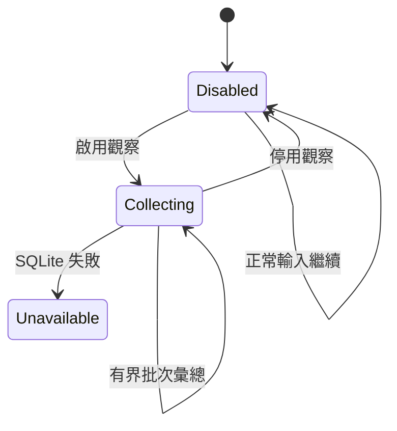
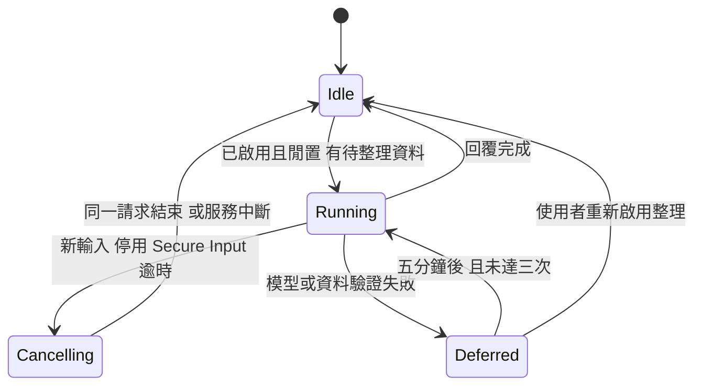
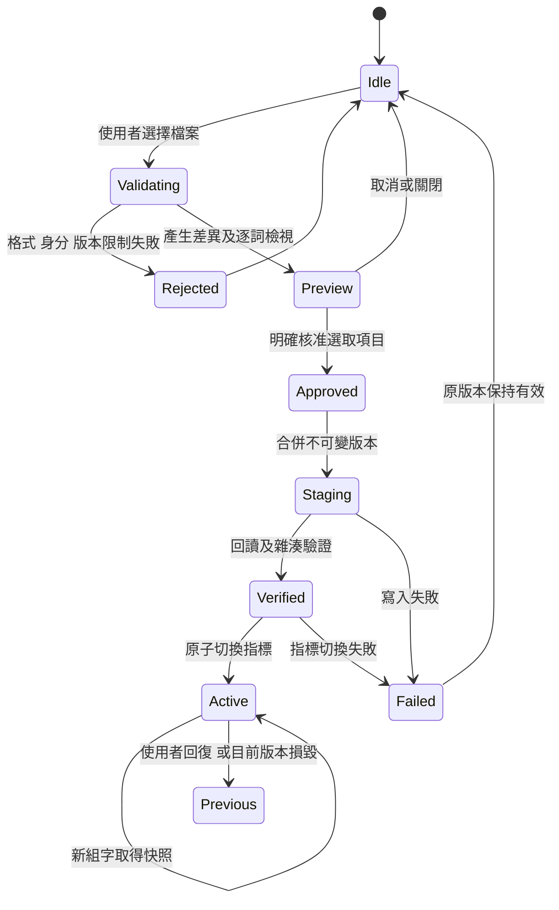

# 實際狀態機

觀察、整理、核准詞庫是獨立控制軸；觀察關閉仍可整理已保存資料。

ModelRequestLease 的 idle/running/cancelling 確保延遲舊回覆不釋放新請求名額。取消結果不能寫入 SQLite；XPC 服務超過 30 秒仍未結束時由自身 watchdog 結束程序。

版本切換不取消組字、不重啟輸入法。停用擴充同樣於安全邊界生效。

更新時間：2026-11-04T02:48:30+08:00
