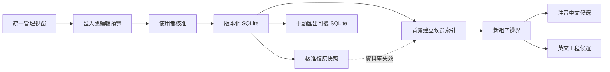

# 統一詞庫 SQLite 交換格式 1.0.0

此格式供 AI注音與 AI 新酷音的使用者詞／工程詞交換。它與既有 `ai-bopomofo.lexicon` JSON 1.0.0 是不同容器，不改動舊 JSON schema。SQL 定義以 [固定 DDL](../../schemas/unified-lexicon-v1.sql) 為準。

## 容器與驗證

- 檔頭為 SQLite 3，`application_id=1095320140`（0x4149424c），`user_version=1`。
- 最大 16 MiB；最多 20,000 詞條、40,000 關聯。重建的 Lexicon JSON 文件仍須符合既有 8 MiB、字元、讀音及欄位限制。
- metadata 恰含四鍵：format=`ai-bopomofo.sqlite`、schema_version=`1.0.0`、document_type=`review`／`approved`、dictionary_version。未知版本及多餘鍵拒絕。
- sqlite_schema 中 SQL 非 NULL 的物件恰為 DDL 的三張表，忽略空白與大小寫後比對；禁止額外表、view、trigger、使用者 index、虛擬表及自訂欄位。SQLite 自建、SQL 為 NULL 的 autoindex 可存在，整體仍須通過 quick_check。
- 外部資料先複製到私有暫存區，再唯讀開啟；trusted_schema 關閉、query_only 開啟、busy timeout 為零。只執行固定查詢，不執行檔案提供的 SQL 或 migration，不載入 extension。
- SQL 值以 UTF-8 讀出，不允許 NULL 或內嵌 NUL。外來檔案不能指定正式路徑。

## 詞條與關聯

entries 的 position 從零連續遞增，保留候選順序；entry_id、term_type、reading、text 必須與 payload 完全相等。payload 是既有 JSON 1.0.0 的單一完整詞條，必須通過既有重複 JSON 鍵、未知欄位與語意檢查。大小寫、上標下標均保留，不做 NFKC。

relations 的 kind 目前只允許 equivalent；source_id 必須指向中文 zh_phrase，target_id 必須指向同檔案的非中文詞條。孤兒、重複或未知關聯拒絕。同一中文詞可連多個工程輸出，同一工程輸出可有多個可靠讀音的中文名稱。

例如合成 fixture 的 `甲烷／ㄐㄧㄚˇ-ㄨㄢˊ` 連到 `ch4 → CH₄` 與 `CH4 → CH4`。注音候選仍輸出「甲烷」，不是自動替換成符號。Windows 原有已組中文轉符號屬獨立路徑，不應由 equivalent 自動觸發。

## 核准與選取匯出

外部 approved 標記不構成本機核准。先預覽，再選取核准；選取匯出／核准會包含關聯相連的必要詞條，UI 明示這個行為。一般匯入保留未列出的本機詞；完整還原與刪除使用另外的替換預覽及確認。

核准部署會清除外來 usage，設定本機 approved 狀態，不將次數灌入引擎詞頻。這不影響純編解碼往返保留 metadata；應分開測試。

SQLite 可完整保留關聯。選取項目含關聯時拒絕直接匯出舊 JSON 1.0，提示改用 SQLite；不將中文別名藏進 annotation 或默默丟棄。

## Mac 本機版本

管理詞庫沿用 Application Support 下的 `AI-Bopomofo/Learning/lexicons/`，與觀察用 learning.sqlite 分開。每個已核准版本包含 lexicon.sqlite、完整復原資料 unified.json 與 receipt.json；active.json 原子切換目前版本。SQLite 是核准版的主要儲存，完整復原資料與歷史版本讓資料庫失效時仍可載入候選。

版本識別為完整值資料的 canonical JSON SHA-256；receipt 另外記錄 SQLite 檔案摘要。檔案摘要不表示詞彙語意相等，也不作跨平台雲端先後順序。舊版本的 lexicon.json 與 receipt 可讀，使用者下次核准後轉存新格式；原版本仍可回復。

匯出從同一個不可變核准快照重新建立獨立 SQLite 並關閉連線，才輸出檔案；不複製正在寫入的 SQLite／WAL／SHM，也不需要遠端服務。

核准與合併後的資料已不同於來源檔；匯出管理快照使用 `snapshot-` 加內容摘要作交換版本。部分選取與完整快照有不同版本，避免沿用來源版號而產生內容衝突。同一來源檔分次核准仍保留原來源摘要。預覽失效判斷使用本機內容版本，而非可重用的顯示版號。

## 固定測試資料

[unified-v1.sqlite](../../research/lexicon-learning/shared-fixtures/unified-v1.sqlite) 由 Python sqlite3 依固定 DDL 建立，包含三詞條與兩關聯；[unified-v1.json](../../research/lexicon-learning/shared-fixtures/unified-v1.json) 是完整預期值，僅供測試，不作一般匯入入口。

fixture SHA-256：`30fd51248890dd027719a53f6c1bc5f5a87005aec0459c0ee6968c5c687266f5`。Swift 必須讀取獨立 fixture 後，匯出再讀仍保持全部值；Windows 用同一資料驗證。不得把一邊自產自讀算成雙平台驗收。

另保存 Rust 產生的 [rust-unified-v1.sqlite](../../research/lexicon-learning/shared-fixtures/rust-unified-v1.sqlite) 與 Swift 產生的 [swift-unified-v1.sqlite](../../research/lexicon-learning/shared-fixtures/swift-unified-v1.sqlite)，三份檔案皆僅含同一組公開合成詞。不同 SQLite 檔案的位元組摘要可以不同；完整解碼後的值必須相同。
