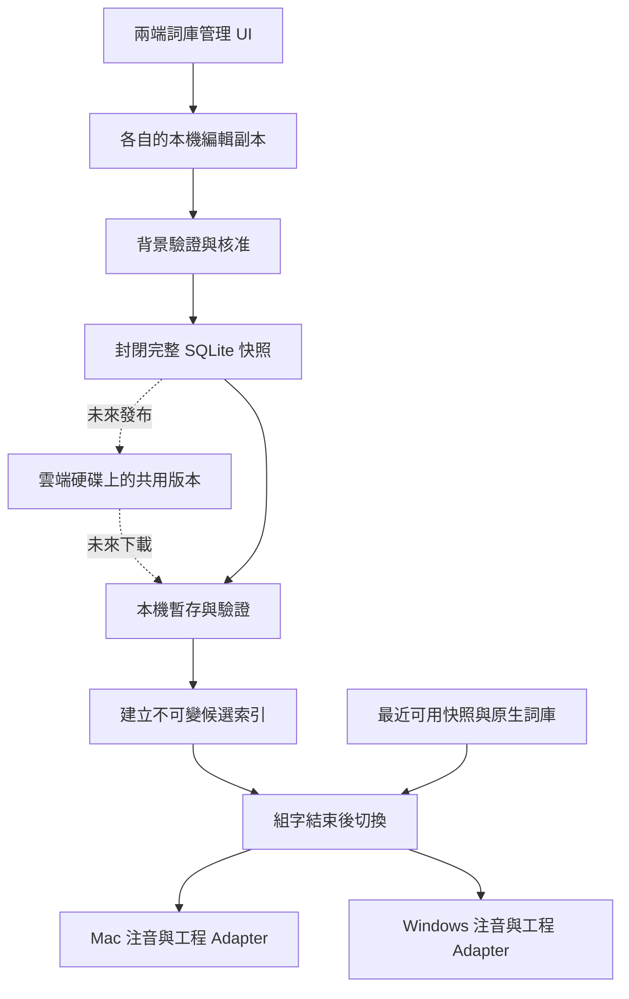

# 使用者與工程詞庫統一 SQLite 規劃

更新時間：2026-11-09T00:30:51+08:00

狀態：規劃中。此文件描述後續設計，不代表 0.6.15／Windows 1.1.1 已具備這些功能。本輪僅文件與委派審查，不修改執行程式、讀寫私人詞庫、安裝、同步或部署。

## 已確認方向

使用者中文詞與工程專業詞由同一份詞彙管理 SQLite 管理。中文別名有可靠讀音後，成為可用注音選取的正式中文詞；工程輸入碼、Unicode 與 ASCII 輸出維持各自的對應。兩端 UI 使用共同欄位與操作語意，保留平台原有介面技術與組字引擎。

未來共用來源為使用者指定的雲端同步資料夾，例如 Google Drive。App 只讀寫固定檔名 `lexicon.sqlite` 的完整快照，其他名稱的衝突副本一律忽略，不刪除也不合併。使用者接受詞彙變更遺失；若雲端內容與上次同步基準不同，直接採用雲端版並放棄尚未發布的本機修改。中央服務、provider API、分散式鎖及逐筆合併均不是本階段需求。

自動同步每週最多一次，不因新增詞、每整點、檔案變更或每次啟動反覆同步。使用者重視本機打字與簡單管理，不要求即時跨機一致。AI 學習循環與語境記憶延期；未來 AI 可以提議時機，但不能自行繞過週期限制或核准詞彙。本輪仍只規劃，不啟用雲端傳輸。

「同一份」是同一個邏輯詞庫及管理模型；各裝置仍需要可離線使用的本機副本和不可變候選索引。應用程式不直接開啟雲端同步資料夾中的可寫 SQLite。

## 現況與遷移對象

| 資料 | 現況 | 規劃 |
|---|---|---|
| Mac 傳統使用者詞 | 預設 data.txt，路徑可自訂，另有排除詞 | 透過來源 Adapter 預覽與匯入，保留原檔及排除語意 |
| Windows 傳統使用者詞 | fork 的 chewing.dat，由引擎管理 | 先確認受支援列舉／讀音 API；不得自行猜測二進位格式 |
| 工程詞 | 獨立短碼、輸出、中文提示；Windows 另有中文轉換別名 | 統一管理並保留來源、分類與各種輸出；說明文字不自動當詞條 |
| 已核准共用詞 | JSON 1.0.0、版本與本機核准紀錄 | 納入遷移與匯入 Adapter，保留版本回復與授權邊界 |
| 長期觀察 | Mac learning.sqlite | 本階段維持獨立，未核准觀察不得混入正式詞庫 |
| 上游內建詞庫 | 引擎資源與預載工程資料 | 保留原資源與著作權；可建立管理索引，不覆寫上游詞庫 |

目前工程詞的 `aliases` 為 ASCII 輸入碼，`annotation` 是顯示提示；共用 `zh_phrase` 則需要漢字與標準注音逐字對應。現有實作參考 [EngineeringLexicon.swift](../../Packages/MixedInputCore/Sources/MixedInputCore/EngineeringLexicon.swift) 與 [LexiconSchema.swift](../../Packages/LexiconLearning/Sources/LearningCore/LexiconSchema.swift)。

## 統一資料模型草案

| 實體 | 主要內容 | 約束 |
|---|---|---|
| 詞條 | 精確輸出文字、類型、來源、分類、啟用狀態 | 大小寫與 Unicode 不做 NFKC；同字不同來源可保留來源關聯 |
| 輸入對應 | 詞條 ID、輸入種類、注音或短碼、核准狀態 | 多讀音、多短碼合法；注音與英文碼不可混用 |
| 詞條關聯 | 中文名稱、Unicode、ASCII 等相關形式的關聯 | 關聯不等於自動轉換，不強制合併同名異義詞 |
| 顯示資訊 | 短提示、查證來源、分類 | 不進入實際提交文字，不從提示猜讀音 |
| 審核與版本 | 修改批次、來源版本、核准紀錄、快照資訊 | 外部 approved 字串不能直接授予本機部署權限 |
| 遷移紀錄 | 來源識別、摘要、匯入結果與拒絕理由 | 重跑不得重複新增；原檔變更需重新預覽 |

實體內部 ID 與既有交換格式的 `entry_id` 分開；既有類型＋讀音／碼＋文字的穩定雜湊不可默默重定義。SQL schema、JSON schema 與 app 版本各自管理。SQL DDL、索引、外鍵、上限與 migration 必須在兩端盤點完成後共同固定。

例如「二氧化矽」中文詞連結到 `SiO₂`、`SiO2`，工程輸入碼為 `sio2`。中文詞需明確讀音；多音字可保留多組經確認的讀音。缺讀音的名稱可保存與搜尋，但不啟用注音候選。

## 候選與 UI 行為

同一編輯視窗提供中文名稱、注音、工程短碼、輸出形式、分類與來源。一般中文詞不必有工程短碼，工程詞也不強制有中文名稱。保存時顯示哪個對應可用、哪個仍缺讀音或核准。

- 注音輸入選到中文別名時，提交中文名稱，不自動改成化學式或符號。
- 工程短碼沿用原文第一候選、明確選取才轉換，Unicode 編輯仍按完整字元處理。
- Windows 既有「已組好的中文別名轉符號」保留為獨立路徑；不能因資料整併將它當成注音讀音，也不直接替 Mac 新增此行為。
- 同音不同詞、同字不同音、同碼多種大小寫與符號均可共存。
- 不把使用次數直接換算成引擎分數；原有短期偏好與自動組句維持原行為。
- 中文擴充先採 candidate_only。可靠的組字跨度與候選提交必須經各端 Adapter 驗證。

## 本機運作與未來快照交換

以下為目標架構，不是目前執行圖。雲端區塊留待後續實作。

SQLite 操作、快照生成、JSON 編解碼與網路皆不在按鍵路徑。各輸入連線持有自己的快照，提交或取消後才切換。資料庫失效時使用最近可用的核准快照；沒有快照仍可用原生詞庫打字。

未來發布時，以 SQLite Backup API 等一致性機制產生獨立完整檔案，關閉發布副本後才交給雲端資料夾。不得直接複製正在寫入且可能依賴 WAL 的主檔。接收端必須取得完整本機檔，驗證大小、格式、schema、完整性與詞條語意，才建立新索引。校驗碼可檢查完整性，不代表可信身分或核准。

## 每週一次交換與 SHA 判斷

「上傳／下載」在 App 內是對指定同步資料夾發布／讀取。Google Drive 等同步軟體負責真正的網路傳輸。寫入本機資料夾不能顯示為另一台已收到或雲端上傳完成；同步軟體可能尚未下載最新版，此限制由使用者接受。

比較三項資訊：`base_sha` 是上次成功接受或發布的完整快照 SHA-256；`remote_sha` 是固定路徑完整副本的 SHA；本機是否有已保存、已核准的詞庫修改另以 dirty／generation 記錄，必要時產生候選快照的 `local_sha`。不將修改後的 local_sha 直接與 remote_sha 比較來推斷雲端是否改變。

| 檢查結果 | 動作 |
|---|---|
| 無法完整讀取或驗證固定檔案 | 保留本機，不上傳、不清除 dirty，顯示此次未完成 |
| remote_sha 與 base_sha 不同 | 雲端版優先；驗證後替換本機詞庫、放棄待發布修改，更新 base，不再次上傳 |
| remote_sha 與 base_sha 相同，本機有詞庫修改 | 產生一致快照；內容不同才發布至固定檔名 |
| 兩邊快照內容相同 | 更新同步紀錄，無需再複製或發布 |
| 無本機變更 | 保持本機，不為上傳而重新產生快照 |
| 首次設定且固定檔案有效 | 先採用雲端版，建立 base |
| 首次設定且使用者確認新資料夾為空 | 可明確初始化發布本機快照；不可把讀取失敗或 placeholder 當成檔案不存在 |

下載不設定本機 dirty；接受遠端不會引起回傳循環。dirty 僅代表管理操作造成的核准詞庫變更，正常打字、候選觀察、AI 建議及 SQLite 內部維護不算待發布修改。發布時捕捉 generation，期間又新增的變更不可被先前發布完成清除。當雲端優先覆蓋時，資料層交易與管理 UI 必須序列處理，讓尚在編輯中的表單明確失效／重載，不將半筆編輯寫進新版。

另提供獨立的「強制上傳本機詞庫」按鈕：只有使用者主動操作才執行，不受每週排程限制，略過雲端不同時先下載的分支。以本機已保存、已核准且通過驗證的完整快照覆蓋固定檔名，即使雲端已有不同版本也採本機版。UI 清楚說明會覆蓋另一台尚未帶入的詞彙；不能由 AI、排程或失敗重試自行觸發。保留 SQLite 一致性、固定目標路徑及寫入失敗保護。成功後更新 base 與發布 generation；不能將「本機檔案已寫入同步資料夾」說成遠端已同步完成。

「手動同步」仍走 SHA 判斷與雲端優先；「強制上傳」才指定本機優先，兩個動作不可混成同一個按鈕。強制操作不啟動額外背景重試。

SQLite 相同詞條不一定有相同檔案位元組；檔案 SHA 是快照識別，不是詞彙語意相等判斷。接收後保留原快照識別，避免把本機開檔／整理產生的位元組差異誤判為新詞，再觸發上傳。

排程草案：自上次自動嘗試起滿七天，於下一個可執行時機最多執行一次；休眠／關機期間漏掉多週不補跑多次。不建立每次按鍵、每次檔案變更或持續網路輪詢。失敗保留舊資料並等下一週，使用者需要時可主動按一次手動同步；手動操作不觸發連續自動重試。首次啟用的初始化操作與每週排程分開顯示。排程週期屬後續實作規格，現階段未註冊任何服務。

檢查後到發布前仍可能有另一台寫入；一般同步資料夾沒有跨機原子比較與替換保證。本階段接受這個競態可能造成詞彙遺失，不額外架設中央服務或要求每次衝突人工合併。其他檔名一律忽略；也不保證每一種同步服務都會留下衝突副本。

固定檔案仍須完整性與語意驗證，不因使用者接受衝突損失就載入損毀資料。選定資料夾並啟用自動採用後，以該來源作詞庫交換；未核准 AI 建議不封裝進正式快照。外部匯入與既有 JSON 核准流程繼續保留。

## 同步案例驗收草案

以下是後續測試需求，尚未執行產品測試：

| 案例 | 預期 |
|---|---|
| 同基準、只有本機修改 | 週期到期後發布一次 |
| 雲端已改、本機也改 | 採用雲端，丟棄待發布本機修改，不合併、不回傳 |
| 本機無變更、雲端已改 | 下載採用一次 |
| 兩端相同 | 無複製／發布 |
| 使用者強制上傳且雲端不同 | 不先下載；本機完整快照覆蓋固定檔名，不受週期限制 |
| 排程／AI 要求強制上傳 | 不允許；僅接受明確手動操作 |
| 下載未完成或 placeholder | 保留舊詞庫，此週不忙迴圈重試 |
| WAL 有已提交資料 | Backup API 快照包含這些資料，不攜帶 WAL／SHM |
| SQL schema 不支援 | 拒絕載入，不依猜測忽略未知 schema |
| 正在組字 | 保留該連線舊索引，提交／取消後才切換，不以超時強切 |
| 發布期間又編輯 | 新 generation 仍待發布 |
| 多個衝突副本 | 僅識別精確固定檔名 |
| 一週內多次開啟／新增詞 | 自動同步最多一次；不因本機改動補跑 |
| 離線多週後恢復 | 到可執行時只做一次，不補跑所有錯過週期 |
| 未設定來源或未啟用 | 不讀寫任意雲端路徑 |
| 時鐘偏移、雲端延遲 | 不以 mtime 判定勝負，不聲稱真實最後版本或全域一致 |

## 分期與兩端分工

| 階段 | 交付 | 驗收 |
|---|---|---|
| 規劃盤點 | 本文件、Windows 配合文件、GIS／AGY 審查 | 確認 API 能力與未知限制，不讀私人實檔 |
| 統一模型 | SQL DDL、migration、合成 fixtures、匯入預覽 | 多讀音、多輸出、大小寫、Unicode、排除與重複資料一致 |
| 本機整合 | 統一編輯 UI、中文與工程 Adapter、安全快照載入 | 中文別名可注音選字，原輸入行為不回歸 |
| 遷移交付 | 使用者核准的遷移、備份、回復與舊介面相容 | 不重複匯入；舊檔被外部修改可被偵測；失敗可回退 |
| 遠期快照共用 | 固定檔名、每週一次、base SHA 與雲端優先替換 | 離線、雲端優先覆蓋與不重複傳輸驗證後才開放 |
| 遠期 AI 學習循環 | 背景統計、提案與人工核准 | 模型輸出不可自動變成正式詞彙 |

Mac 負責 Swift／Objective-C++ Adapter 與既有資料目錄相容；Windows Codex 配合確認 libchewing API、TSF 快照生命週期、工程別名與設定 UI。OpenCode GIS 處理有界方案草稿與案例矩陣，AGY 協助 Windows 盤點；最終規格與成果由各端 Codex 審查。

## 驗收與尚待決策

測試需覆蓋中文別名缺音／多音、英文大小寫、上下標、舊詞與排除詞、取消／重跑遷移、資料庫唯讀／損毀／寫入失敗、組字中切換、F 分層、雙 Shift 及快捷鍵。快照階段另測雙端同時編輯、離線重連、時鐘偏移、下載未完成、WAL 快照、schema 不支援、組字中到貨、未信任來源。

尚待兩端確認：私人詞 API 可用性、原生自動學習寫入的邊界、舊文字編輯入口如何相容、排除詞優先序、SQL schema／遷移版本、工程預載資料與個人修改的覆蓋規則。雲端資料夾由使用者設定；不要求 provider API，也不承諾真實雲端進度、衝突副本存在或即時一致。

本輪只有文件檢查及 GIS 工作副本驗證；沒有產品程式測試、GUI、實鍵或真實雲端同步驗收。已發布版本的操作仍見 [共用詞庫整合紀錄](shared-integration.md)。

委派與人工審查紀錄見 [GIS 審查紀錄](unified-sqlite-review.md)。
