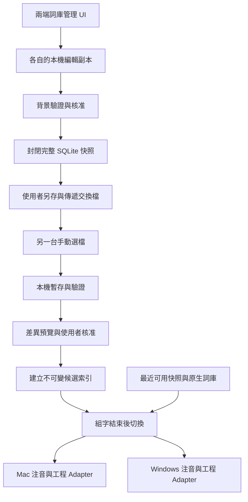

# 使用者與工程詞庫統一 SQLite 規劃

更新時間：2026-11-09T23:11:06+08:00

狀態：以下保留規劃階段紀錄。Mac `feature/v1-unified-lexicon` 已進入 1.0.0-dev.1 實作，實際格式以 [SQLite 交換契約](unified-sqlite-format.md) 為準，操作與原詞檔保留限制見 [使用指南](unified-sqlite-user-guide.md)。0.6.15／已發布 Windows 1.1.1 不因本文件更新就具備新 SQLite 功能；雲端同步仍未實作。

## 已確認方向

使用者中文詞與工程專業詞由同一份詞彙管理 SQLite 管理。中文別名有可靠讀音後，成為可用注音選取的正式中文詞；工程輸入碼、Unicode 與 ASCII 輸出維持各自的對應。兩端 UI 使用共同欄位與操作語意，保留平台原有介面技術與組字引擎。

近期優先採手動匯入／匯出，讓公司電腦在無法安裝雲端同步軟體時也能使用。兩端各自有本機 SQLite，透過使用者選擇的交換檔攜帶詞彙；「同一份」指共同資料模型與統一管理，不要求兩台連線共用運作中的資料庫。

每週自動同步、指定雲端資料夾、SHA 衝突仲裁、強制上傳及中央服務均延後，先前討論保留於 [雲端快照延後方案](deferred-cloud-snapshots.md)。AI 學習循環與語境記憶亦維持遠期規劃。本次沒有啟用資料傳輸或實際匯入私人詞庫。

## 現況與遷移對象

| 資料 | 現況 | 規劃 |
|---|---|---|
| Mac 傳統使用者詞 | 預設 data.txt，路徑可自訂，另有排除詞 | 透過來源 Adapter 預覽與匯入，保留原檔及排除語意 |
| Windows 傳統使用者詞 | fork 的 chewing.dat，由引擎管理 | 先確認受支援列舉／讀音 API；不得自行猜測二進位格式 |
| 工程詞 | 獨立短碼、輸出、中文提示；Windows 另有中文轉換別名 | 統一管理並保留來源、分類與各種輸出；說明文字不自動當詞條 |
| 已核准共用詞 | JSON 1.0.0、版本與本機核准紀錄 | 納入遷移與匯入 Adapter，保留版本回復與授權邊界 |
| 長期觀察 | Mac learning.sqlite | 本階段維持獨立，未核准觀察不得混入正式詞庫 |
| 上游內建詞庫 | 引擎資源與預載工程資料 | 保留原資源與著作權；可建立管理索引，不覆寫上游詞庫 |

目前工程詞的 `aliases` 為 ASCII 輸入碼，`annotation` 是顯示提示；共用 `zh_phrase` 則需要漢字與標準注音逐字對應。現有實作參考 [EngineeringLexicon.swift](../../Packages/MixedInputCore/Sources/MixedInputCore/EngineeringLexicon.swift) 與 [LexiconSchema.swift](../../Packages/LexiconLearning/Sources/LearningCore/LexiconSchema.swift)。

## 統一資料模型草案

| 實體 | 主要內容 | 約束 |
|---|---|---|
| 詞條 | 精確輸出文字、類型、來源、分類、啟用狀態 | 大小寫與 Unicode 不做 NFKC；同字不同來源可保留來源關聯 |
| 輸入對應 | 詞條 ID、輸入種類、注音或短碼、核准狀態 | 多讀音、多短碼合法；注音與英文碼不可混用 |
| 詞條關聯 | 中文名稱、Unicode、ASCII 等相關形式的關聯 | 關聯不等於自動轉換，不強制合併同名異義詞 |
| 顯示資訊 | 短提示、查證來源、分類 | 不進入實際提交文字，不從提示猜讀音 |
| 審核與版本 | 修改批次、來源版本、核准紀錄、快照資訊 | 外部 approved 字串不能直接授予本機部署權限 |
| 遷移紀錄 | 來源識別、摘要、匯入結果與拒絕理由 | 重跑不得重複新增；原檔變更需重新預覽 |

實體內部 ID 與既有交換格式的 `entry_id` 分開；既有類型＋讀音／碼＋文字的穩定雜湊不可默默重定義。SQL schema、JSON schema 與 app 版本各自管理。SQL DDL、索引、外鍵、上限與 migration 必須在兩端盤點完成後共同固定。

例如「二氧化矽」中文詞連結到 `SiO₂`、`SiO2`，工程輸入碼為 `sio2`。中文詞需明確讀音；多音字可保留多組經確認的讀音。缺讀音的名稱可保存與搜尋，但不啟用注音候選。

## 候選與 UI 行為

同一編輯視窗提供中文名稱、注音、工程短碼、輸出形式、分類與來源。一般中文詞不必有工程短碼，工程詞也不強制有中文名稱。保存時顯示哪個對應可用、哪個仍缺讀音或核准。

- 注音輸入選到中文別名時，提交中文名稱，不自動改成化學式或符號。
- 工程短碼沿用原文第一候選、明確選取才轉換，Unicode 編輯仍按完整字元處理。
- Windows 既有「已組好的中文別名轉符號」保留為獨立路徑；不能因資料整併將它當成注音讀音，也不直接替 Mac 新增此行為。
- 同音不同詞、同字不同音、同碼多種大小寫與符號均可共存。
- 不把使用次數直接換算成引擎分數；原有短期偏好與自動組句維持原行為。
- 中文擴充先採 candidate_only。可靠的組字跨度與候選提交必須經各端 Adapter 驗證。

## 本機運作與手動檔案交換

以下為近期目標架構，不是目前執行圖。

SQLite 操作、快照生成、JSON 編解碼與網路皆不在按鍵路徑。各輸入連線持有自己的快照，提交或取消後才切換。資料庫失效時使用最近可用的核准快照；沒有快照仍可用原生詞庫打字。

匯出時，以 SQLite Backup API 等一致性機制產生獨立完整檔案，關閉匯出副本後才完成另存。不得直接複製正在寫入且可能依賴 WAL 的主檔。接收端必須取得完整本機檔，驗證大小、格式、schema、完整性與詞條語意，才建立新索引。校驗碼可檢查完整性，不代表可信身分或核准。

## 手動匯入與匯出

Mac 與 Windows 提供一致操作，不要求安裝 Google Drive 等同步軟體，也不需要雲端帳號或連線。使用者自行選擇檔案儲存位置與傳遞方式；App 不背景上傳或自動搜尋外部檔案。

| 操作 | 規劃行為 |
|---|---|
| 匯出選取詞彙 | 選擇一般中文詞或工程詞，輸出必要的讀音、短碼、文字、關聯與來源 |
| 匯出完整詞庫 | 建立可攜的完整資料快照，不直接複製運作中的 SQLite 主檔 |
| 匯入詞庫 | 選檔、背景驗證、預覽新增／重複／衝突，再由使用者確認採用 |
| 完整還原 | 與一般匯入分開；清楚顯示將替換哪些本機資料，確認後才還原 |
| 回復上一版 | 匯入或還原失敗時保留既有版本，成功後仍可回復 |

匯入不是自動整份覆蓋；先前對雲端衝突的資料遺失容忍，不延伸為手動匯入授權。一般匯入未列出的本機詞保留，重複詞不重加，同音不同詞共存，矛盾的同身分資料須在預覽中處理。缺讀音的中文名稱保持待補狀態，不猜讀音啟用。

完整交換格式優先規劃為獨立 SQLite 快照，輸出僅含可攜詞彙資料，不含私人觀察資料庫、完整輸入紀錄、本機路徑、認證或可直接沿用的核准憑證。選取匯出須包含相關對應的必要資料，不能產生斷裂的詞條關聯。兩端須共同固定 SQL schema、相容版本、大小／詞數上限與合成 fixtures，才可宣稱完整無損交換。

現有 JSON 1.0.0 匯入／匯出繼續保留，不因改用 SQLite 管理就移除。新關聯無法由舊格式表示時，明確提示限制，不默默省略；不得宣稱現有 JSON 已支援全部新欄位。

接收端只經受限資料 Adapter 解析允許的結構與詞條，不直接把外部檔案取代正在使用的資料庫或執行檔內任意 SQL／migration。匯入工作在背景進行，完成核准及新索引建立後，等待輸入連線的安全邊界切換。

## 近期驗收草案

以下是後續測試需求，尚未執行產品測試：

- 不安裝雲端軟體、無網路時，兩端仍能匯出、選檔、預覽與匯入。
- 中文名稱及讀音、工程短碼、大小寫、上下標與詞條關聯可往返；選取匯出保留必要關聯。
- 匯入取消不改資料，重複匯入不多加詞，缺少某詞不自動刪除本機詞。
- 格式不支援、檔案截斷、惡意結構或寫入失敗均保留原詞庫，不強行降級格式。
- WAL 的已提交內容可經一致快照匯出，不需要搬 WAL／SHM。
- 組字中匯入不強制切換候選；提交／取消後才採新索引。
- 完整還原有獨立確認與回復；不沿用先前雲端自動覆蓋規則。
- 不匯出未選資料、觀察紀錄或本機核准憑證，不觸發排程、網路或模型。

## 分期與兩端分工

| 階段 | 交付 | 驗收 |
|---|---|---|
| 規劃盤點 | 本文件、Windows 配合文件、GIS／AGY 審查 | 確認 API 能力與未知限制，不讀私人實檔 |
| 統一模型 | SQL DDL、migration、合成 fixtures、匯入預覽 | 多讀音、多輸出、大小寫、Unicode、排除與重複資料一致 |
| 本機整合 | 統一編輯 UI、中文與工程 Adapter、安全快照載入 | 中文別名可注音選字，原輸入行為不回歸 |
| 遷移交付 | 使用者核准的遷移、備份、回復與舊介面相容 | 不重複匯入；舊檔被外部修改可被偵測；失敗可回退 |
| 手動跨平台交換 | 選取／完整匯出、匯入預覽、核准與獨立還原 | 無網路可用，兩端資料往返、取消與回復通過 |
| 延後雲端共用 | 每週同步與強制上傳等原構想 | 不列入近期完成條件，另行啟動才實作 |
| 遠期 AI 學習循環 | 背景統計、提案與人工核准 | 模型輸出不可自動變成正式詞彙 |

Mac 負責 Swift／Objective-C++ Adapter 與既有資料目錄相容；Windows Codex 配合確認 libchewing API、TSF 快照生命週期、工程別名與設定 UI。OpenCode GIS 處理有界方案草稿與案例矩陣，AGY 協助 Windows 盤點；最終規格與成果由各端 Codex 審查。

## 驗收與尚待決策

測試需覆蓋中文別名缺音／多音、英文大小寫、上下標、舊詞與排除詞、取消／重跑遷移、資料庫唯讀／損毀／寫入失敗、組字中切換、F 分層、雙 Shift 及快捷鍵。交換階段另測離線匯出／匯入、檔案不完整、WAL 快照、schema 不支援、組字中匯入、未信任來源。

尚待兩端確認：私人詞 API 可用性、原生自動學習寫入的邊界、舊文字編輯入口如何相容、排除詞優先序、SQL schema／遷移版本、工程預載資料與個人修改的覆蓋規則。近期不需要選定雲端服務或資料夾，也不承諾即時一致。

本輪只有文件檢查及 GIS 工作副本驗證；沒有產品程式測試、GUI、實鍵或真實雲端同步驗收。已發布版本的操作仍見 [共用詞庫整合紀錄](shared-integration.md)。

委派與人工審查紀錄見 [GIS 審查紀錄](unified-sqlite-review.md)。
