# 1.1.0-dev.1 開發交付

更新時間：2026-11-13T02:15:17+08:00

## 變更與原因

1.0.4 的 F 處理比 Shift 英文更早攔截事件，使 Shift＋F 沒有進入首字母長按流程。本版明確排除按著 Shift 時新啟動 F 分層，沿用原本含計時與 repeat 備援的英文轉小寫流程。

依使用者確認，移除立即 F 組合鍵：門檻內下一鍵一律正常打字。F key-down 顯示由目前配置計算的 marked preview；真正引擎在短按確定時只接收一次原事件。長按只撤回 preview，不傳送刪除事件、不回頭修改已送出文件。

偏好設定沿用既有宿主，新增 F 分層分頁，提供 QWERTY 映射、留白停用、還原預設、分層與首字母兩個獨立時間。自訂映射可輸入 Unicode，編輯／刪除沿用完整字元邊界。每次進層保存不可變映射快照，途中設定變更不改動正在處理的符號。

選單保留 10 個常用操作；其餘在可捲動工具視窗中由明確接收者執行，避開 IMK 子選單 action 問題。Cmd＋Ctrl＋G／H 對應選項保留第一層；系統附加項目不由本程式移除。

```mermaid
stateDiagram-v2
    [*] --> Idle
    Idle --> English: Shift + F
    Idle --> Preview: unshifted F down
    Preview --> Idle: F up / next key before deadline; replay once
    Preview --> Held: elapsed > deadline; remove preview
    Held --> Idle: F up; finish symbols
    Preview --> Idle: cancellation
    Held --> Idle: focus / permission / secure cancellation
```

## 已測試

`scripts/test-headless.sh`：323 項通過，2 項既有 C++ 案例略過。

| 測試群組 | 通過 |
| --- | ---: |
| C++ | 124 |
| MixedInputCore | 92 |
| CandidateRanking | 40 |
| LexiconLearning | 39 |
| Python | 28 |

涵蓋門檻前、恰好門檻、門檻後、F 放開順序、重複事件與延後通知、符號鍵歸屬、首字母 F／S、設定驗證、Unicode 插入與退格。舊立即組合鍵測試依新契約調整為正常連打與逾時啟動，未刪除測試以隱藏錯誤。

輸入法整合目標已 build-for-testing，包含預覽不改引擎及映射快照測試，**僅編譯、未執行**。Release 編譯與 bundle 身分、詞庫、模型服務、簽章檢查通過。

本機紀錄：`/tmp/f-layer-headless.log`、`/tmp/f-layer-integration-build.log`、`/tmp/f-layer-release.log`。

## 尚未驗證與限制

- 未執行 GUI、hosted IME、音效、模擬鍵盤或實鍵測試。新工具視窗 action、偏好分頁排版、iTerm2／其他應用的 marked text 行為待使用者驗收。
- Shift＋F 轉小寫需開啟 Shift 英文組字；雙 Shift 的直接英文不使用這項組字功能。
- 若系統無法提供即時按住狀態，轉小寫可能等到 repeat 或放開事件才結算；不能保證 UI 精確在設定毫秒當下刷新。
- 新酷音舊本機路徑本次不存在，未讀取或修改 Windows 專案；此交付依使用者要求提供 QWERTY 實體鍵位編輯，不宣稱兩平台設定格式已共用。
- [實鍵驗收清單與操作](../quick-symbols.md)。

## 邊界

版本為 1.1.0-dev.1，app 1.1.0 / build 1100，分支 `feature/f-layer-preferences`。新增功能與基本操作變更，按 X.Y.Z 規則遞增第二碼。

不安裝或重啟輸入法、不修改私人詞庫或 Kanata、不合併 main、不建立標籤或 Release。安裝檔與 app ZIP 交付至指定版本資料夾，供使用者手動安裝。
